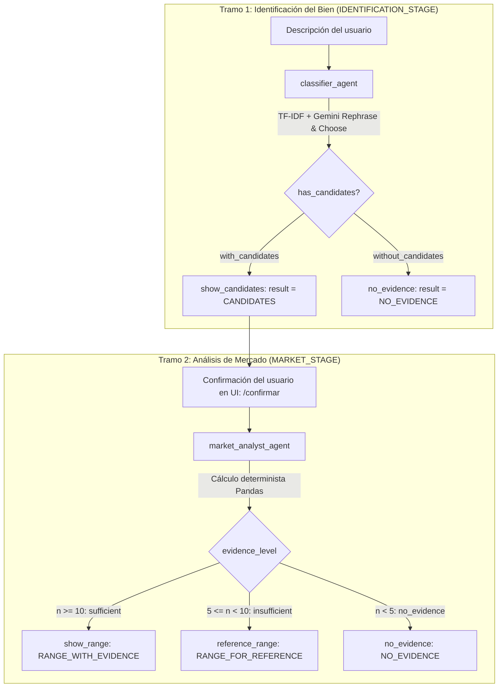

# Documentación Técnica y Análisis Profundo — LicitaFácil

## 1. Estado Actual de la Documentación del Repositorio

Tras auditar el repositorio clonado, el diagnóstico de documentación es el siguiente:

| Nivel de Documentación | Estado | Detalles Encontrados |
| :--- | :--- | :--- |
| **`README.md` (Raíz)** | ❌ **Inexistente** | Solo contiene 1 línea (`# -Aplicaci-n-web-multiagente-Licitaciones-P-blicas`) y está codificado en `UTF-16LE`. No incluye instrucciones de instalación, configuración de `.env`, arquitectura ni comandos de ejecución. |
| **Plantilla de entorno (`.env.example`)** | ❌ **Ausente** | No existe archivo `.env.example` que documente `GEMINI_API_KEY`, `SECRET_KEY`, `GEMINI_MODEL` o las variables de `LangSmith`. |
| **Docstrings y Comentarios en Código** | ✅ **Bien documentado** | Todos los módulos (`app.py`, `orchestrator.py`, `rules.py`, `classifier.py`, `market_analyst.py`, `services/*`) cuentan con docstrings claros en español que explican contratos de entrada/salida y hacen referencia a especificaciones (`SP-002`, `SP-003`) e historias de usuario (`HU-001`, `HU-002`, `HU-003`). |
| **Pruebas y Evidencia Experimental** | ✅ **Excelente** | El directorio `app/tests/` incluye tanto suites unitarias/integración (`test_hu001.py`, `test_hu002.py`, `test_hu003.py`) como scripts y artefactos de validación empírica (`queries_hu001.csv`, `results_hu001.csv`, `control_hu002.csv`, `control_hu002.xlsx`). |

---

## 2. Propósito y Dominio del Sistema

**LicitaFácil** es una aplicación web asistida por un sistema multiagente que permite a empresarios (especialmente MYPES en Perú, con énfasis en el departamento de **La Libertad**) consultar si el bien que comercializan tiene mercado en las contrataciones públicas del Estado peruano y si su estructura de costos es competitiva frente a los precios históricos adjudicados.

### Fuente de Datos (OECE 2023–2025)
- **`app/data/catalog.csv`**: Contiene **2,023 bienes únicos** del catálogo estatal **CUBSO** que registraron al menos 5 adjudicaciones mediante procedimientos de selección entre 2023 y 2025.
  - Columnas: `codigoitem`, `itemcubso`, `unidad_medida`, `n_adjudicaciones`.
- **`app/data/awards.csv`**: Contiene **43,464 registros de adjudicaciones** asociadas a los bienes del catálogo (filtradas de un universo original reportado en portada de 60,024 adjudicaciones).
  - Columnas: `codigoitem`, `unidad_medida`, `anio`, `codigoconvocatoria`, `precio_unitario`, `n_postores`, `entidad_departamento`.

---

## 3. Arquitectura Multiagente y Flujo de Orquestación (`LangGraph`)

El sistema divide su flujo en tramos orquestados mediante `StateGraph` de **LangGraph** en `app/orchestrator.py` y trazados con **LangSmith** (`@traceable`).

### 3.1. Agente 1: Clasificador (`app/agents/classifier.py` — HU-001)
Resuelve el problema de traducir descripciones coloquiales o con errores ortográficos del usuario a códigos oficiales **CUBSO**:
1. **Reformulación Técnica (`PROMPT_REPHRASE`)**: Llama a Gemini (`gemini-3.1-flash-lite`) para traducir términos coloquiales a terminología CUBSO (ej. *"fierro corrugado de media pulgada"* $\rightarrow$ *"barra de acero corrugado para construccion de 1/2 in"*). Si el LLM falla en este paso, el sistema degrada con gracia (`rephrased = None`) y continúa con el texto original.
2. **Preselección Híbrida TF-IDF (`preselect`)**: Al iniciar la app, vectoriza los 2,023 ítems del catálogo usando n-gramas de caracteres con límites de palabra (`analyzer="char_wb"`, `ngram_range=(3, 5)`, `sublinear_tf=True`). Calcula similitud coseno tanto para la descripción original como para la reformulada, uniendo hasta `30` candidatos por búsqueda sin duplicados.
3. **Selección Semántica (`PROMPT_CHOOSE`)**: Envía el subconjunto preseleccionado a Gemini para que elija hasta `3` códigos ordenados del más al menos probable.
4. **Guardrail de Validación (`validate`)**: Filtra cualquier código inventado (alucinación) o repetido contrastando contra `data.VALID_CODES`.

### 3.2. Agente 2: Analista de Mercado (`app/agents/market_analyst.py` — HU-002 y HU-003)
Es un agente **100% determinista** (no utiliza LLM para evitar errores de cálculo o alucinaciones numéricas):
1. **Filtro estricto (`filter_awards`)**: Filtra `awards.csv` exigiendo coincidencia exacta tanto en `codigoitem` como en `unidad_medida`.
2. **Rango de Precios (`compute_price_range` — HU-002)**:
   - Calcula **P25**, **Mediana (P50)** y **P75** con interpolación lineal (`PERCENTIL.INC` de Excel).
   - Calcula la dispersión relativa (rango intercuartílico relativo):
     $$\text{Dispersión} = \frac{P_{75} - P_{25}}{P_{50}}$$
3. **Competencia (`compute_competition` — HU-003)**:
   - Ignora adjudicaciones sin dato en `n_postores` (`dropna`) para no sesgar las métricas.
   - Calcula la **mediana de postores por proceso** (`median_bidders`).
   - Calcula el número y **porcentaje de procesos con postor único** (`n_postores == 1`).
   - Cuenta cuántas adjudicaciones fueron convocadas por entidades del departamento de **La Libertad** (`n_la_libertad`).

---

## 4. Reglas de Negocio (`app/rules.py` — Especificación SP-002)

### 4.1. Niveles de Evidencia según Tamaño de Muestra ($n$)
- **$n < 5$ (`no_evidence`)**: *"Sin evidencia para evaluar"*. El bien no entra al catálogo o no se evalúa.
- **$5 \le n < 10$ (`insufficient_evidence`)**: *"Sin evidencia suficiente"*. Se muestra el rango de precios únicamente como referencia (`RANGE_FOR_REFERENCE`), pero se bloquea la comparación de costos para no emitir un veredicto con muestras pequeñas.
- **$n \ge 10$ (`with_verdict`)**: *"Con veredicto"* (`RANGE_WITH_EVIDENCE`). Habilita las zonas competitivas.

### 4.2. Niveles de Dispersión y Matriz de Confianza
- **Dispersión**:
  - `low`: $\text{IQR}_{rel} \le 0.25$
  - `medium`: $0.25 < \text{IQR}_{rel} \le 0.50$
  - `high`: $\text{IQR}_{rel} > 0.50$
- **Confianza del Veredicto (`confidence_level`)**:

| Tamaño de Muestra ($n$) \ Dispersión | Baja ($\le 0.25$) | Media ($0.25 - 0.50$) | Alta ($> 0.50$) |
| :--- | :---: | :---: | :---: |
| **$10 \le n < 30$** | Media (`medium`) | Baja (`low`) | Baja (`low`) |
| **$n \ge 30$** | Alta (`high`) | Media (`medium`) | Baja (`low`) |

### 4.3. Regla de Veredicto por Costo Unitario (`verdict`)
- $\text{Costo} < P_{25} \implies$ **`participate`** (*"Participa"* / Zona Competitivo)
- $P_{25} \le \text{Costo} \le P_{75} \implies$ **`participate_with_caution`** (*"Participa con cautela"* / Zona Con cautela)
- $\text{Costo} > P_{75} \implies$ **`not_profitable`** (*"No rentable"* / Zona Alto costo)

---

## 5. Estado del Flujo de Usuario (5 Pasos Planeados)

La barra de progreso (`app/templates/_step.html`) y la portada (`describe.html`, que menciona 4 agentes y 5 pasos) revelan la hoja de ruta del producto:

1. **Paso 1 (`GET /`) — Completo**: Formulario para describir el bien (`describe.html`).
2. **Paso 2 (`POST /candidatos`, `GET /candidatos`) — Completo**: Selección y confirmación de hasta 3 candidatos CUBSO (`candidates.html`).
3. **Paso 3 (`GET /mercado`) — Completo**: Visualización del rango intercuartílico de precios (HU-002) e indicadores de competencia (HU-003) (`market.html`).
4. **Paso 4 (Ingreso de costo unitario) — Pendiente en UI/Rutas**: En `market.html` (líneas 127–136), el botón `"Ingresar mi costo"` está deshabilitado (`disabled`) con la nota: *"El ingreso del costo estará disponible en la siguiente versión"*.
5. **Paso 5 (Veredicto y Recomendación) — Parcial**:
   - Las funciones matemáticas de veredicto y confianza (`verdict()`, `confidence_level()`, `dispersion_level()`) **ya están programadas** en `app/rules.py`.
   - La plantilla `result.html` actualmente solo cubre el estado vacío (*"Sin evidencia para evaluar"* en el Paso 5). Falta implementar los agentes/nodos de evaluación de costo y recomendación final (los 2 agentes restantes para completar los "4 agentes" anunciados en la portada).

---

## 6. Pruebas y Validación de Calidad (`app/tests/`)

1. **`test_hu001.py` (16 tests)**: Valida el clasificador, fallback cuando falla la reformulación, descarte de códigos inexistentes, grafo de LangGraph del Tramo 1 y rutas Flask con modelo simulado (`fake_model`).
2. **`test_hu002.py` (12 tests)**: Verifica cálculo exacto de percentiles contra `numpy.percentile(..., method="linear")`, filtrado por código + unidad, umbrales de evidencia, determinismo estricto (`no_model`) y formato de moneda peruana (`S/`).
3. **`test_hu003.py` (10 tests)**: Verifica mediana de postores ignorando `NaN`, porcentaje de postor único, conteo en `"LA LIBERTAD"` y renderizado HTML.
4. **`control_hu002.py` + `control_hu002.xlsx`**: Script de auditoría estadística que muestrea 30 bienes estratificados (10 de 5–9 adjudicaciones, 10 de 10–29, y 10 de 30+) con semilla `SEED = 2026`, comparando los resultados del agente contra el módulo estándar `statistics` de Python y generando un archivo Excel con fórmulas vivas (`PERCENTILE.INC`, `MEDIAN`, `COUNTIF`), logrando **0 discrepancias**.
5. **`run_queries_hu001.py` + `results_hu001.csv`**: Benchmark real contra la API de Gemini usando las consultas de `queries_hu001.csv`.

---

## 7. Puntos de Mejora Identificados
1. **`pyrightconfig.json` y `.vscode/settings.json`**: Tienen rutas hardcodeadas de macOS del autor original (`/Users/bensonhilario/Documents/App Licitaciones/...` y `.venv/bin/python`). En Windows conviene ajustarlas a rutas relativas o `.venv/Scripts/python.exe`.
2. **`README.md`**: Está vacío y en codificación `UTF-16LE`.
3. **Archivos basura de macOS**: Existen archivos `.DS_Store` trackeados en la raíz y en `app/`.
